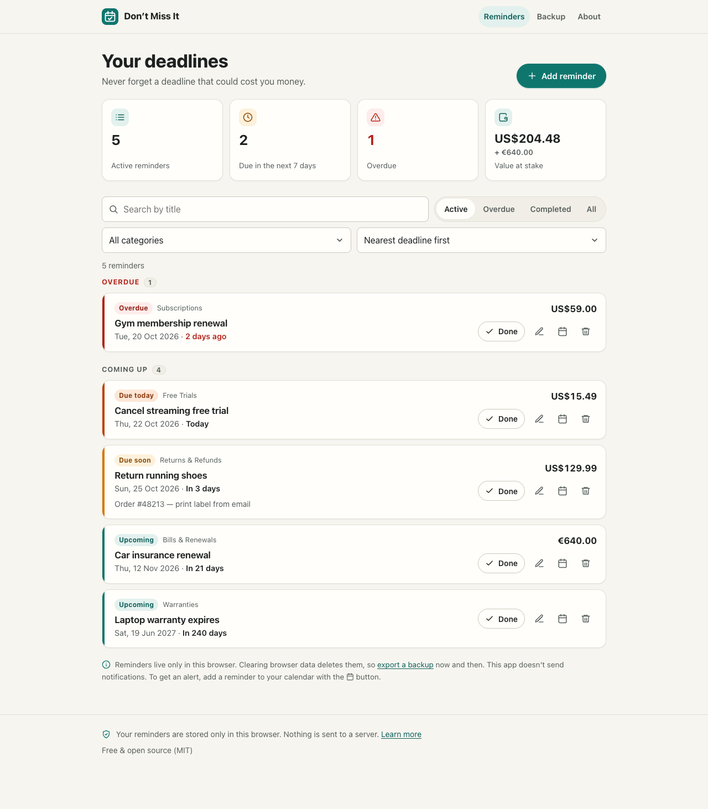
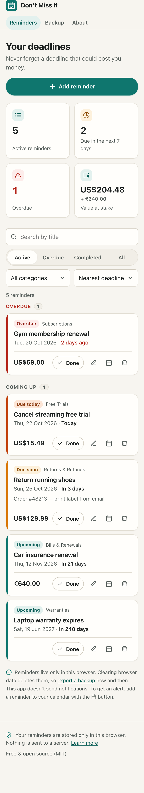

# Don't Miss It

**Never forget a deadline that could cost you money.**

Don't Miss It is a free, open-source deadline tracker for everyday money deadlines:
return windows, subscription renewals, free trials, warranties, insurance and
membership renewals. It runs entirely in your browser. There's no account, no
server and no tracking, and your reminders never leave your device.



<details>
<summary>Mobile screenshot</summary>



</details>

## Features

- **Dashboard**: active reminders, what's due in the next 7 days, overdue items, and
  the total value at stake (shown per currency, never mixed or converted).
- **Reminders**: create, edit, complete, reopen and delete, with a title, category,
  deadline, optional amount and currency, and notes.
- **Automatic statuses**: Overdue, Due today, Due soon (1–7 days), Upcoming, Completed.
  Days are counted by calendar date in your own time zone.
- **Search, filter and sort**: by title, category, and status (active / overdue /
  completed / all), with nearest or latest deadline first.
- **Calendar export**: download any reminder as an `.ics` file for Apple Calendar,
  Google Calendar, Outlook and others. The event includes an alarm one day before.
- **Backup and restore**: export everything to a JSON file and import it on another
  device. Imports are fully validated, and you're asked before existing data is replaced.
- **Private by design**: data is stored in `localStorage`. No analytics, ads, trackers,
  external fonts or third-party requests.
- **Accessible and responsive**: keyboard friendly, screen-reader labels, visible focus,
  reduced-motion support, and a mobile-first layout.

> **Notifications:** Don't Miss It does not send push notifications or emails. It shows
> what's due whenever you open it. For an alert, export the reminder to your calendar.

## Privacy

- Reminders and settings are saved in your browser's `localStorage`, on your device only.
- Nothing is sent to any server. The app makes no network requests after loading.
- No accounts, cookies, analytics, advertising or AI services.
- **Back up your data.** Clearing browser data, using private browsing or switching
  browsers or devices means your reminders won't be there. Use **Backup → Export
  backup** regularly.
- If stored data is ever unreadable, the app keeps a copy under a
  `dont-miss-it:recovery:*` key in localStorage instead of deleting it.

## Getting started

Requirements: [Node.js](https://nodejs.org/) 20.19+ or 22.12+ (as required by Vite 8) and npm.

```bash
npm install
npm run dev        # start the dev server at http://localhost:5173
```

### Scripts

| Command             | What it does                                   |
| ------------------- | ---------------------------------------------- |
| `npm run dev`       | Start the development server                   |
| `npm test`          | Run the unit tests once (Vitest)               |
| `npm run test:watch`| Run tests in watch mode                        |
| `npm run typecheck` | Type-check the app and tests with `vue-tsc`    |
| `npm run build`     | Type-check and build to `dist/`                |
| `npm run preview`   | Serve the production build locally             |

## Deployment (free)

The build is a static site in `dist/`. It uses relative asset paths (`base: './'`) and
hash-based URLs (`#/about`), so it works at a domain root **or** under a sub-path with no
server configuration.

### GitHub Pages (recommended)

1. Push this repository to GitHub.
2. Go to **Settings → Pages** and set **Source** to **GitHub Actions**.
3. Push to `main`. The workflow in [`.github/workflows/deploy.yml`](.github/workflows/deploy.yml)
   runs the tests, builds the site and publishes it to
   `https://<your-username>.github.io/<repository-name>/`.

### Cloudflare Pages

1. In the Cloudflare dashboard, open **Workers & Pages → Create → Pages → Connect to Git**
   and choose your repository.
2. Use these build settings:
   - Framework preset: **None** (or Vue)
   - Build command: `npm run build`
   - Build output directory: `dist`
   - Environment variable (if needed): `NODE_VERSION` = `22`
3. Save and deploy. No redirects or functions are needed.

Any other static host (Netlify, Vercel, a plain web server) works the same way: build,
then serve `dist/`.

## Configuration and donation link

All deployment-specific settings live in one file: [`src/config.ts`](src/config.ts).

```ts
export const config = {
  appName: 'Don’t Miss It',
  donationUrl: '',     // e.g. 'https://www.buymeacoffee.com/yourname'
  repositoryUrl: '',   // e.g. 'https://github.com/yourname/dont-miss-it'
}
```

### Support the project ☕

Don't Miss It is free, with every feature available to everyone. If it has saved you some
money, you're welcome to support its development:

**Buy me a coffee:** _link coming soon_ <!-- Replace with your Buy Me a Coffee URL -->

Donation links in the app stay **hidden** until `donationUrl` is set, so a fork never shows
a broken or placeholder link. Donations are entirely optional and there are no pop-ups.

## Project structure

```
src/
  components/    UI building blocks (cards, form, dialogs, filters, toasts)
  views/         Pages: Dashboard, Backup & settings, About & privacy
  composables/   Shared state (reminders, toasts, today's date, routing)
  services/      Storage, backup import/export, .ics generation, downloads
  types/         Reminder data model and constants
  utils/         Pure logic: dates, currency, filtering/sorting, validation
  config.ts      Donation and repository links
tests/           Vitest unit tests for the business logic
```

### Data model

Stored in `localStorage` under the key `dont-miss-it`:

```jsonc
{
  "version": 1,
  "preferences": { "currency": "USD" },
  "reminders": [
    {
      "id": "6f1c…",
      "title": "Return running shoes",
      "category": "returns",      // returns | subscriptions | trials | warranties | bills | other
      "deadline": "2026-11-05",   // local calendar date, never parsed as UTC
      "amount": 129.99,           // or null
      "currency": "USD",          // ISO 4217, or null when there's no amount
      "notes": "",
      "createdAt": "2026-10-22T09:00:00.000Z",
      "completed": false,
      "completedAt": null
    }
  ]
}
```

Backup files use the same shape with an extra `"app": "dont-miss-it"` and `"exportedAt"`.
When the schema changes, bump `SCHEMA_VERSION` and add a migration step in
[`src/services/storage.ts`](src/services/storage.ts).

## Contributing

Contributions are welcome! Please read [CONTRIBUTING.md](CONTRIBUTING.md). In short: keep
it small, private and dependency-light, add tests for logic changes, and make sure
`npm test` and `npm run build` pass.

## Reporting issues

Found a bug or have an idea? Open an issue on GitHub using the bug report or feature
request template. For date-related bugs, please include your time zone. **Please don't
attach your real backup file or personal reminder details.** Make up an example instead.

## License

[MIT](LICENSE)
